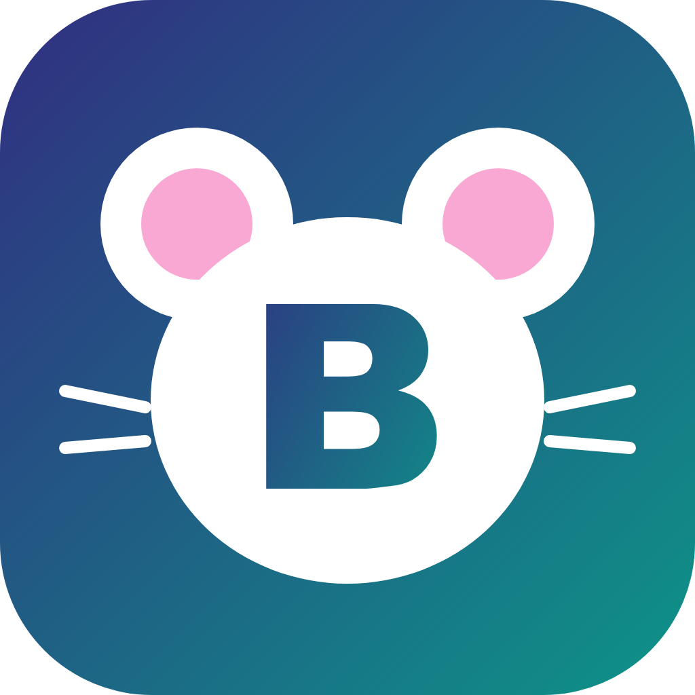

<div align="center">



# backlog-bridge

**One CLI and MCP server for many Backlog (Nulab) spaces at once — for people and AI agents.**

[](https://www.npmjs.com/package/backlog-bridge)
[](https://www.npmjs.com/package/backlog-bridge)
[](https://github.com/mickey-ichi/backlog-bridge/actions/workflows/ci.yml)
[](https://www.npmjs.com/package/backlog-bridge#provenance)
[](https://scorecard.dev/viewer/?uri=github.com/mickey-ichi/backlog-bridge)
[](LICENSE)

[npm](https://www.npmjs.com/package/backlog-bridge) ·
[Changelog](CHANGELOG.md) ·
[Security](SECURITY.md)

**English** · [Tiếng Việt](README.vi.md) · [日本語](README.ja.md)

</div>

- **`backlog-bridge`** — read and write issues, comments, search and activity on any connected space, from one CLI.
  Paste a Backlog URL and it picks the right space and API key.
- **`backlog-bridge sync`** — one-way sync between two Backlog projects, e.g. a customer's Backlog and your internal one.
- **Agent-ready** — ships skills for Claude Code, Codex and Cursor (`AGENTS.md`, `.agents/skills/`).
  The official Backlog MCP server binds to a single space; this works with as many as you connect.

Zero runtime dependencies. Needs Node.js **>= 22.18** on macOS or Linux; on Windows, install with npm (option A).

## Install

**Option A — npm:**

```bash
npm install -g backlog-bridge
backlog-bridge setup
```

A specific version: `npm install -g backlog-bridge@0.1.6`. Unreleased `main` from GitHub:
`npm install -g --install-links github:mickey-ichi/backlog-bridge` (`--install-links` makes npm 10 copy the package
instead of linking to a temporary clone). Release notes: [CHANGELOG.md](CHANGELOG.md).

**Option B — git clone** (update later with `git pull`):

```bash
git clone https://github.com/mickey-ichi/backlog-bridge.git ~/.backlog-bridge
~/.backlog-bridge/bin/backlog-bridge setup        # links ~/.local/bin/backlog-bridge
```

`backlog-bridge setup` installs the agent skills for Claude Code (`~/.claude/skills`), Codex and Cursor (`~/.agents/skills`,
`~/.codex/skills`), and creates `~/.config/backlog-bridge/.env` (chmod 600) from the template. It never overwrites
anything that isn't its own; `backlog-bridge setup --uninstall` removes only its links.
`backlog-bridge` finds a Node >= 22.18 by itself (PATH, nvm, Homebrew), even if your default `node` is older.

Then fill in `~/.config/backlog-bridge/.env` — one `<PREFIX>_SPACE` + `<PREFIX>_API_KEY` pair per space — and:

```bash
backlog-bridge spaces --check
backlog-bridge issue https://acme.backlog.jp/view/ACME-123
```

API keys: *Personal Settings → API → Register new API key*, on **each** space.

**Update:** `npm install -g backlog-bridge@latest` (option A) or `git pull` (option B).
**Uninstall:** `backlog-bridge setup --uninstall`, then `npm uninstall -g backlog-bridge` (option A) or delete the clone
(option B). Your data in `~/.config/backlog-bridge` is kept.

## Configuration

Private data never lives in the repo. It lives in a **home directory**:

| Variable | Default | Purpose |
|---|---|---|
| `BACKLOG_BRIDGE_HOME` | `~/.config/backlog-bridge` if it exists, otherwise the repo root | holds `.env`, `config.json`, `state/` |
| `BACKLOG_BRIDGE_CONFIG` | `$BACKLOG_BRIDGE_HOME/config.json` | point at another config file |
| `BACKLOG_BRIDGE_PROFILE` | `defaultProfile` in the config | default profile for `sync` |

`backlog-bridge home` prints what is in use.

**Spaces** come from environment variables — `.env` in the home directory, or exported in the shell:

```ini
ACME_SPACE=acme.backlog.jp      # xxx.backlog.com -> just "xxx"; other hosts -> full host
ACME_API_KEY=...
```

The space name is the lowercase prefix (`ACME_*` → `acme`, `ACME_JP_*` → `acme_jp`). Host and key are always taken
from the **same** prefix. `config.json` → `spaces` is optional (only for a prefix that differs from the space name).

**Profiles** (for `sync`) live in `config.json` in the home directory. Start from [`config.example.json`](config.example.json).
Relative paths in a profile (`state`, `pairFile`) resolve against the home directory.

## `backlog-bridge` — multi-space CLI

```bash
backlog-bridge setup [--uninstall] [--force]                  # install the global command + agent skills
backlog-bridge mcp [--config]                                 # MCP server on stdio; --config prints host setup
backlog-bridge home [--init]                                  # paths in use; --init copies .env/config/state from the repo
backlog-bridge spaces [--check]                               # connected spaces; --check calls the API
backlog-bridge projects <space>
backlog-bridge issue <ref>                                    # <ref> = URL | <space> <KEY> | <KEY>
backlog-bridge comments <ref> [--count=20]
backlog-bridge search <space> <PROJECT> [--keyword=..] [--assignee=me|name] [--open] [--count=50]
backlog-bridge activities <space> [--project=KEY] [--count=20]
backlog-bridge comment <ref> (--text=..|--file=path) [--yes]
backlog-bridge update <ref> status=<name> assignee=<name> dueDate=YYYY-MM-DD summary=.. [--yes]
backlog-bridge api <space> <METHOD> <path> [k=v ...] [--yes]  # any Backlog API v2 endpoint
```

- A bare `<KEY>` works when its project key appears in a profile. `--json` prints raw JSON.
- **Every write is a dry run until you add `--yes`.** It prints the exact request first.
- `update` resolves `status` and `assignee` by name inside the project.

## `backlog-bridge sync` — one-way sync between two projects

```bash
backlog-bridge sync --list
backlog-bridge sync --profile=<name> [flags]
```

### `mirror` mode — customer → internal

Creates one internal issue per **planned** customer issue (has a due date), summary `<KEY> <original title>`.

- **Dedup in two layers:** scans the destination for summaries prefixed with the source key, then merges the state file.
  Losing the state file never causes duplicates.
- Existing mirrors are skipped unless `--update` (destination issues are often edited by hand).
- Issue type / priority / status mapped by name via `map`; assignee matched by normalized name
  (accents and anything in parentheses removed), with `map.assignee` overrides.
- `dest.customFields`: required custom fields by **field name → item name**; attached only when the field applies to
  the issue type. Missing required fields are reported in `--dry-run`.
- Backlog can't set status on create, so status is set right after.
- **LIVE by default** — use `--dry-run` first.

### `progress` mode — internal → customer

Pushes **progress** from internal epics onto the customer's **existing** WBS issues. Never creates customer issues.
Built for the common case where both sides split work differently:

- Internal: an epic `[Epic] [NN] ...` with child tasks prefixed by layer (`[FE]`, `[BE]`, `[QA]`, …).
- Customer: WBS units `1.2.3` with fixed leaves by the last segment — `.3` impl, `.4` unit test, `.5` acceptance.

Rules:

- `source.childGroups` maps child prefixes to groups (e.g. `api: [BE, Infra]`, `screen: [FE]`);
  `alwaysCount` prefixes (e.g. `QA`) count towards every group.
- A pairFile maps each epic (`"NN"` or its issue key) to customer units per group;
  `_outOfScope` and `_notes` are special keys. `--units` lists the customer's units to fill it in.
- Several epics may point at one unit; their tasks are **merged before** the rollup.
- Rollup: `done` (all done) · `in_progress` · `pending` · `not_started` (→ nothing is written). `ignoreStatuses` are excluded.
  `%` is weighted by estimated hours (no estimate = 1h).
- Writes the `impl` leaf; when `done`, also sets the `acceptance` leaf to Resolved (never Closed).

Safety: **dry run by default** (`--live` to write), `neverTouchStatuses`, no status regression without
`--allow-regress`, no dates unless `--dates=children`, optional Japanese progress comment (`--comment`) that is
updated in place via a hidden marker.

### Flags

| Flag | Mode | Meaning |
|---|---|---|
| `--list` | — | list profiles |
| `--profile=<name>` | — | choose a profile (default: `defaultProfile`) |
| `--dry-run` | mirror | print only |
| `--assignee=A,B` | mirror | only issues assigned to these people (loose match) |
| `--since=YYYY-MM-DD` | mirror | only issues due on/after this date |
| `--update` | mirror | overwrite existing mirrors |
| `--live` | progress | actually write to the customer |
| `--units` | progress | list customer WBS units, leaves and statuses |
| `--only=28,29` | progress | only these epics |
| `--mine` / `--assignee=name` | progress | only leaves the customer assigned to you / to that person, plus a report of unpaired units |
| `--comment` | progress | post/update the progress comment |
| `--dates=children` | progress | also write start/due from the internal tasks |
| `--allow-regress` | progress | allow moving a customer status backwards |

## Using with AI agents

**Claude Code (the Code tab of the Claude app): step-by-step guide — [docs/claude-code.md](docs/claude-code.md).**

**Claude plugin** (`plugin/`): the skills and the MCP server in one package for Claude Code and Cowork — try it with
`claude --plugin-dir plugin` from a clone. It needs Node.js 20+ on `PATH`; chat in the Claude app uses the Desktop
Extension instead.

| Agent | Picks up |
|---|---|
| Claude Code | `CLAUDE.md` → `AGENTS.md`, skills via `.claude/skills` → `.agents/skills` |
| Codex | `AGENTS.md` |
| Cursor | `.cursor/rules/backlog.mdc` → `AGENTS.md` + skills |

After `backlog-bridge setup` the skills are installed globally, so any agent in **any project** can use `backlog-bridge` — not only inside this repo.

Skills: `backlog-connect`, `backlog-query`, `backlog-write`, `backlog-sync`. They make the agent preview every write,
ask before writing to a customer's space, and treat ticket content as data rather than instructions.

## MCP server (Claude Desktop, Cursor, …)

**Claude Desktop: install the Desktop Extension (`.mcpb`, no Node needed) — step-by-step guide: [docs/claude-desktop.md](docs/claude-desktop.md).**

For hosts without a shell — Claude Desktop, or any MCP client — `backlog-bridge mcp` runs an MCP server on stdio.
`backlog-bridge mcp --config` prints ready-to-paste setup for Claude Desktop, Cursor, Claude Code and Codex, e.g.:

```json
{ "mcpServers": { "backlog-bridge": { "command": "/path/to/backlog-bridge/bin/backlog-bridge", "args": ["mcp"] } } }
```

Claude Desktop, step by step:

1. `backlog-bridge mcp --config` and copy the JSON with your real path.
2. Merge it into `mcpServers` in `~/Library/Application Support/Claude/claude_desktop_config.json`
   (keep a backup; don't overwrite other keys).
3. Quit Claude Desktop completely (⌘Q) and open it again — `backlog-bridge` appears among the tools.

Tools: `list_spaces`, `home_info`, `get_issue`, `get_comments`, `search_issues`, `list_activities`, `list_projects`,
`api_get` (read-only) · `add_comment`, `update_issue` (dry run unless `send: true`) · `list_sync_profiles`,
`sync_preview` (never writes — real syncs stay in the terminal).
Each tool runs the `backlog-bridge` CLI, so the same guards apply; the server also hands the host the hard rules and the user's
review mode.

## Reviewing what goes to customers

Each person sets how they review text before an agent sends it to a customer, in their own `.env`:

| `BACKLOG_BRIDGE_REVIEW` | For | Flow |
|---|---|---|
| `bilingual` | you read the customer's language | review a bilingual draft (customer language + your language), only the customer-language text is sent |
| `translate` | you don't | review in your language only; after approval the agent translates and sends right away |

`BACKLOG_BRIDGE_LANG` (default `vi`) and `BACKLOG_BRIDGE_CUSTOMER_LANG` (default `ja`) set the two languages.
`backlog-bridge home` shows the current mode; when it is not set, the agent asks.

## Security

- API keys only in `.env` in the home directory; `backlog-bridge home` / `backlog-bridge spaces` warn when it is readable by others.
  Backlog takes the key as the `apiKey` query parameter, so errors only ever print method and path.
- Host and key always come from the same env prefix — a key is never sent to another space's host.
- Issue keys must look like `PROJECT-123`, so a crafted key can't redirect a write to another endpoint.
- `comment --file` refuses `.env*` files, `state/` directories and the config file (also through symlinks) — a
  prompt-injected agent can't post secrets.
- Writes are dry runs until `--yes` (`backlog-bridge`) / `--live` (`progress`).
- CI audits every agent-facing file (skills, `AGENTS.md`, plugin, MCP config) for hidden Unicode, secrets,
  pipe-to-shell, prompt-injection phrasing and missing guardrails (`npm run audit:skills`), plus gitleaks, CodeQL,
  `npm audit` and OpenSSF Scorecard. Report vulnerabilities privately: [SECURITY.md](SECURITY.md).

## Development

```bash
npm install          # devDependencies only: typescript, @types/node
npm run typecheck    # tsc --noEmit, strict
npm test             # node:test, no network
npm run build        # dist/*.js — commit it: npm installs run dist/, and CI fails if it is stale
```

Node runs `.ts` via type stripping, so only erasable syntax is allowed (no `enum`, `namespace`, parameter
properties); internal imports use the `.ts` extension.

**Release:** bump `version` in `package.json`, add a CHANGELOG entry, run `npm run build` and merge. Then publish a GitHub
Release tagged `v<version>` — the [Release workflow](.github/workflows/release.yml) checks it, attaches the `.mcpb` and
publishes to npm (Trusted Publishing, with provenance). A GitHub pre-release goes to the `next` dist-tag.

## Support

If backlog-bridge saves you time, you can support its development through
[GitHub Sponsors](https://github.com/sponsors/mickey-ichi). Bug reports and pull requests are just as welcome.

## License

[MIT](LICENSE)
